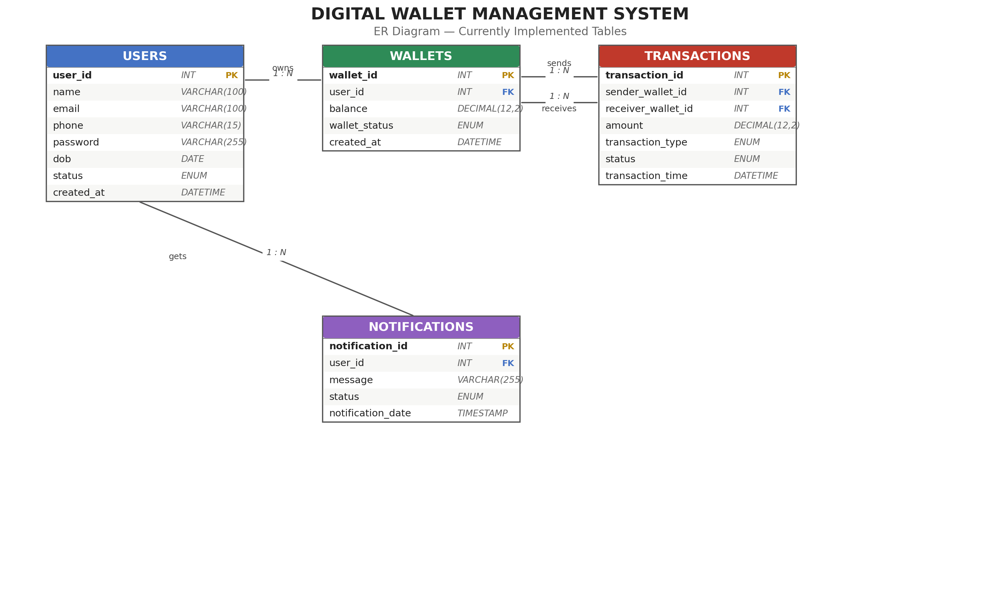

# Digital Wallet Management System

A console-based digital wallet application built in **C++** with a **MySQL** backend. Users can register, log in, manage their wallet balance, transfer money to other users, and view their transaction history and notifications. Includes an admin panel for user management.

---

## Features

- **User Registration & Login** - secure account creation with an auto-created wallet on signup
- **View Profile** - see your registered account details
- **Wallet Management** - check balance, add money, withdraw money (with insufficient-balance protection)
- **Transfer Money** - send funds to another user by email, with checks against self-transfers and invalid receivers
- **Transaction History** - view all sent/received transfers
- **Notifications** - automatic in-app messages for wallet activity (money added, sent, received)
- **Admin Panel** - view all users, block/unblock accounts, view all transactions system-wide

---

## Tech Stack

| Layer | Technology |
|---|---|
| Language | C++ |
| Database | MySQL 8.0 |
| DB Connectivity | MySQL C API (`mysql.h`) |
| Compiler | GCC 16 (MSYS2 UCRT64) |
| IDE | VS Code |
| Build | Manual `g++` compilation |

---

## ER Diagram

The database was originally designed with 7 tables (see `ER_Diagram_Full.png`). The tables currently wired into the application are shown below:



**Tables in use:** `Users`, `Wallets`, `Transactions`, `Notifications`
**Designed but not yet implemented in the app:** `Cashback`, `Blocked_Users` (reason logging), `Login_History`

---

## Project Structure

```
digwalletproj/
│
├── SQL/
│   ├── 01_create_tables.sql
│   ├── 02_insert_data.sql
│   ├── 03_views.sql
│   ├── 04_stored_procedures.sql
│   ├── 05_triggers.sql
│   ├── 06_indexes.sql
│   ├── 07_reports.sql
│   └── 08_basic_queries.sql
│
├── src/
│   ├── main.cpp            # Entry point, menus, dashboard flow
│   ├── database.h / .cpp   # MySQL connection handling
│   ├── user.h / .cpp       # Register, Login, Profile, Notifications
│   ├── wallet.h / .cpp     # Balance, Add Money, Withdraw
│   ├── transaction.h / .cpp # Transfer Money, Transaction History
│   ├── admin.h / .cpp      # Admin: view users, block/unblock, view transactions
│
├── er_diagram_implemented.png
├── ER_Diagram_Full.png
└── README.md
```

---

## Database Setup

1. Install MySQL Server 8.0 and ensure the service is running.
2. Create the database and a dedicated user:
   ```sql
   CREATE DATABASE DigitalWallet;
   CREATE USER 'wallet_user'@'localhost' IDENTIFIED BY 'wallet123';
   GRANT ALL PRIVILEGES ON DigitalWallet.* TO 'wallet_user'@'localhost';
   FLUSH PRIVILEGES;
   ```
3. Run the scripts in `SQL/` in order (starting with `01_create_tables.sql`) to create the schema.

---

## Build & Run

Open **MSYS2 UCRT64** (not PowerShell or CMD - required for GCC/DLL resolution), then:

```bash
cd /c/Users/asus/Documents/digwalletproj

g++ src/main.cpp src/database.cpp src/user.cpp src/wallet.cpp src/transaction.cpp src/admin.cpp \
-I"/c/Program Files/MySQL/MySQL Server 8.0/include" \
-L"/c/Program Files/MySQL/MySQL Server 8.0/lib" \
-lmysql \
-o DigitalWallet.exe

./DigitalWallet.exe
```

**If the app exits with code 127** (DLL not found), copy the MySQL client DLL next to the executable:
```bash
cp "/c/Program Files/MySQL/MySQL Server 8.0/lib/libmysql.dll" .
```

---

## Usage

**Main Menu**
```
1. Register
2. Login
3. Admin Login
4. Exit
```

**User Dashboard** (after login)
```
1. View Profile
2. Check Balance
3. Add Money
4. Withdraw Money
5. Transfer Money
6. Transaction History
7. View Notifications
8. Logout
```

**Admin Dashboard** (default credentials: `admin` / `admin123`)
```
1. View All Users
2. Block User
3. Unblock User
4. View All Transactions
5. Logout
```

---

## Known Limitations / Future Improvements

- Passwords are stored in plaintext - a production version would use hashing (e.g. bcrypt).
- Admin credentials are hardcoded rather than stored in a dedicated `Admins` table.
- Transfer logic uses sequential `UPDATE` statements rather than a wrapped MySQL transaction (`BEGIN`/`COMMIT`/`ROLLBACK`), so a mid-transfer failure isn't atomic.
- `Cashback`, `Blocked_Users` (reason logging), and `Login_History` are designed in the schema but not yet connected to the application logic.

---

## Author

Built as a learning project to understand C++ OOP design, relational database modeling, and direct database connectivity without an ORM.
